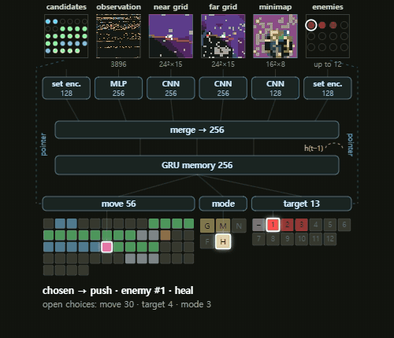
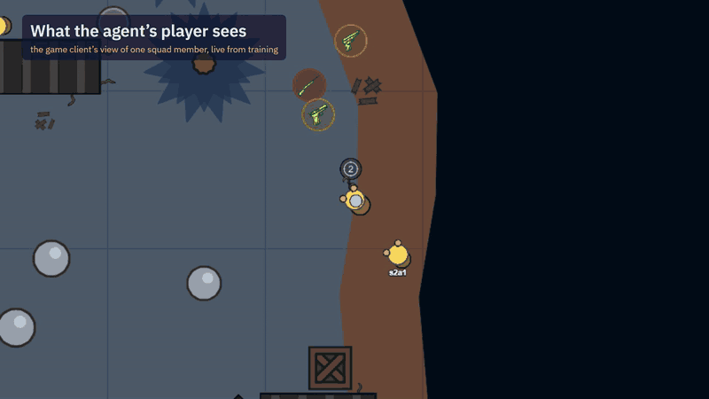

# survevBot

Squads of four AI agents that learned to play a 2D battle royale with multi-agent reinforcement learning (MAPPO), trained on one desktop PC. A personal research project.

**[Watch full matches in your browser](https://123wwwa.github.io/survevbot-demo/)** · [short clip](https://www.youtube.com/shorts/PPAVNHRAb7k) (October 2026 model)

*The network of one agent deciding live, in training: its inputs, the encoders, the GRU memory, and the three output heads with the choices that are open (bright) and the one taken.*

The game is [survev](https://github.com/survev/survev), an open-source clone of surviv.io. Everything here ran on the unmodified open-source game server on a local machine, and nobody in the replays is human.

## At a glance

| | |
|---|---|
| Algorithm | MAPPO: centralized training, decentralized execution |
| Agents | squads of 4, 10–17 squads (40–68 players) per game |
| Policy | recurrent actor (CNNs + set encoders + GRU), about 3.4M parameters, one decision every 0.25 s |
| Training | about 1,100 hours of run time and about 125k policy updates, 9 October – 28 November 2026, still running |
| Hardware | one desktop PC: Ryzen 7 7800X3D, RTX 5070 12 GB, 32 GB RAM |
| Result | against a hand-written expert bot in the same games: 2.3× its kills per squad, 71% of one-on-one fights won (896 games, 24–27 November 2026) |

## The problem

- **Multi-agent**: four teammates act together against many other squads at once.
- **Partial observability**: each agent sees only what its own player could see (its screen area and a minimap), never the full game state.
- **Delay**: every player sees the world late and its inputs arrive late.
- **Long horizon**: a match lasts minutes; looting early pays off in fights much later.
- **Limited compute**: one consumer GPU and an 8-core CPU.

## Approach

**Hierarchical policy.** Every 0.25 s the policy chooses *where to go* (an intent, mostly picked among candidate destinations), *who to engage* (one of the enemies it knows about, or nobody) and *what to use*. The low-level control under it is not learned and is not described here. The learning problem is the decision making.

**What goes in.** The clip below is real footage from training: one agent's own game view, and the network's inputs captured at the same moments ([MP4](media/inputs-in-game.mp4)).

**MAPPO with centralized training, decentralized execution.**

- **Actor**, shared by the four squad members, using only that agent's own observations:
  - a feature vector (own state, items, teammates, surroundings) → MLP
  - egocentric grids at two scales → small CNNs
  - a coarse whole-map grid → small CNN
  - set encoders over the known enemies and over candidate destinations (shared MLP with max + mean pooling, so these summaries do not depend on order)
  - all merged → GRU
  - three categorical heads: intent (mostly a pointer over the candidate destinations), target (a pointer over the enemies, or none) and mode; invalid choices are masked
- **Critic**, used only in training: all four members' observations plus a squad-centred global map that includes enemies nobody on the squad can see. It predicts one shared team value.
- **Reward**: terms credited to the agent that earned them (damage, knocks, survival, …) plus team terms (placement, win), summed for the squad; the critic learns the squad's return.
- **PPO**: recurrent PPO over long chunks replayed from stored GRU states, with a long discount horizon (about two minutes of look-ahead).

**Imitation warm start.** The policy first copied the expert bot's decisions (behaviour cloning), then switched to RL. For most of training a small imitation loss on the model's own past best decisions acted as an anchor; it was removed in mid-November.

**Opponents.** A mix of rule-based expert bots (with several play styles) and self-play: the current model and a pool of its past snapshots.

**Simulated delay.** Every player gets its own simulated network delay, varied between games, and the policy is given its delay as an input.

## Results (local simulation)

**Against the rule-based expert bot (current model).** A greedy evaluation runs beside training: model squads and expert-bot squads play in the same games, on the training map, with simulated delay. Over 896 games from 24 to 27 November 2026:

| Measure | Model squads | Notes |
|---|---|---|
| Kills per squad | **2.3×** the bots' (2.22–2.33 by day) | |
| Damage dealt ÷ damage taken | **1.7×** the bots' (1.67–1.72) | |
| One-on-one fights (a knock or kill between a model player and a bot) | **71%** won (70.8–72.3) | about 2,500 fights a day |
| Games won per squad | 11.5% (11.3–11.8) | a fair share would be 7.4% |

The expert bot uses the same low-level control as the model, so the gap is in the decisions.

**Progress over training.** In training games the model also meets a frozen model from 18 October 2026 and the expert bots. Knocks the model dealt for each knock it took, by version:

| Version (dates) | vs the 18 October model | vs the expert bots | Games |
|---|---|---|---|
| v30 (21–22 Oct) | 1.13 | 0.95 | 3,170 |
| v36 (30 Oct) | 1.92 | 1.38 | 957 |
| v44 (11–13 Nov) | 2.58 | 1.67 | 3,231 |
| v46 (22–28 Nov, current) | 2.21 | 1.87 | 13,594 |

Training games sample actions instead of taking the most likely one. From 16 November training moved to a single new map, which explains the dip against the frozen model between v44 and v46; against the bots the trend kept rising.

**Caveats.** These are logs of the running training, not a pre-registered experiment. Observation, reward and skill changes overlap between versions, so there is no clean ablation.

## Outside the simulator

In one uncontrolled test on 1 November 2026 (an earlier model, about update 84,800), a squad of four model-controlled clients played 112 squad games on a public server and won 40 (36%, 95% CI 27–45%). With equal teams, chance would be about 10%. The result depends heavily on network delay, and the other players were human and did not know they were playing bots, so it is reported only as a single aggregate. The bot is not released.

## Training

- **Hardware**: one desktop PC. AMD Ryzen 7 7800X3D (8 cores, 16 threads), NVIDIA GeForce RTX 5070 (12 GB), 32 GB RAM, Windows 11.
- **Setup**: game worker processes on the CPU (currently 8, between 4 and 14 over the project) feed one server and one GPU learner.
- **Time**: about 1,100 hours of training run time from 9 October to 28 November 2026, including branches later rolled back. The model in training is at about 125,000 policy updates, after about 127,000 games and 1.4 billion agent decisions. Training is still going.

## What I learned

- **Learning under delay.** A policy trained without delay did badly once delay was added. Varying the delay per player during training and giving the policy its delay as an input fixed much of it, but play still gets worse as delay grows.
- **What the actor may see.** The actor gets only what its own player could see. A perturbation test (changing enemies' hidden health and checking that no input changes) guards against leaks. The critic may use privileged state; that is the point of centralized training.
- **Team reward and credit assignment.** Rewards are credited to the agent that earned them and summed for the squad, so one critic learns the team's return while individual contributions still show up in the signal.
- **Imitation as an anchor, not only a start.** In October, removing the imitation loss made some learned choices collapse within a few hundred updates, so a small anchor stayed until the policy no longer needed it.
- **Opponent diversity.** Training against scripted bots of several styles, the current self and past snapshots kept the policy from exploiting one opponent's weaknesses.
- **Throughput on one PC.** Recurrent PPO over replayed chunks, parallel CPU game workers and one GPU learner reached over a billion agent decisions on consumer hardware.
- **Measuring honestly.** Some metrics flatter a model. Sample sizes, confidence intervals and chance baselines mattered as much as the training itself.

## The replays

[The replay page](https://123wwwa.github.io/survevbot-demo/) holds 10 full matches, each won by a model squad. Follow any squad or a single player, turn each squad's AI intent lines (where it means to go and who it is targeting) on and off, and jump to any point of a match. `RL · latest` is the model in training, `RL · snapshot` is a saved version of it used as an opponent, and `baseline` is the scripted bot.

The matches were recorded on 14 October 2026 on the desert map, at about update 17,500 (around 95 hours of training): an earlier, smaller version of the model than the one described above.

## Not included

The training code, the bot and the model weights are not published. A bot like this could be abused as a cheat on public servers.

## Credits

Game, images and sounds: [survev](https://github.com/survev/survev), GPL-3.0. This repository is under the same licence. See [NOTICE.md](NOTICE.md).
